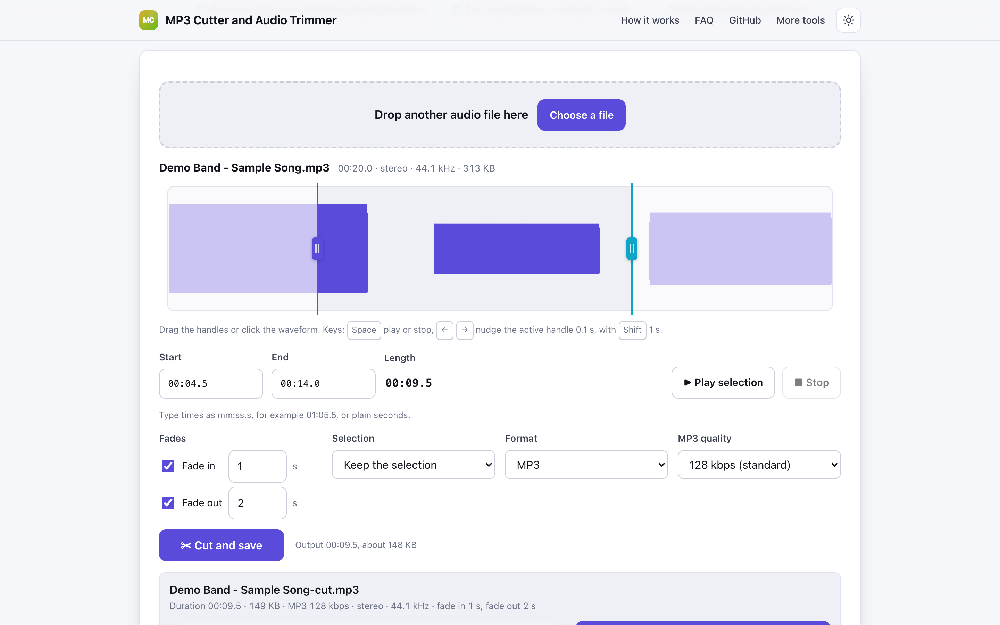
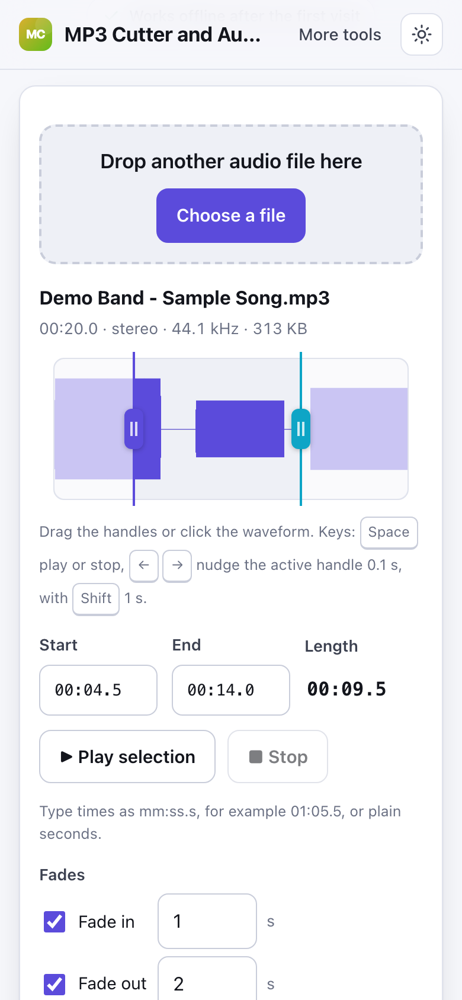

# MP3 Cutter and Audio Trimmer

> Cut and trim MP3, WAV and M4A clips with a waveform in your browser, with nothing uploaded.

**🌐 Use it now: [turhe123.github.io/mp3-cutter-local](https://turhe123.github.io/mp3-cutter-local/)** · free · open source · runs in your browser · works offline


## Why

This is a free, open-source alternative to MP3 Cutter at mp3cut.net, which is an ad-heavy page that pushes an online editor with sign-up for extras and sends large files through a web page you must trust. Here, your files never leave the device. There is no account, no ads and no limits. It works offline and can be installed as an app.

## Screenshots

<p align="center"></p>

<p align="center"><em>MP3 Cutter and Audio Trimmer in the browser, light theme</em></p>

<p align="center"></p>

<p align="center"><em>MP3 Cutter and Audio Trimmer on a phone</em></p>

## Features

- Load one audio file by drag and drop or the file picker.
- Waveform drawn on a canvas (min and max per pixel column, scaled for device pixel ratio) with two draggable trim handles.
- Click the waveform to move the nearer handle, or type exact start and end times (`mm:ss.s` or plain seconds).
- Live readout of start, end and length.
- Play preview of the selection with a moving playhead and a stop button.
- Optional fade in and fade out, each with its own length in seconds (0 to 30).
- "Delete the selection, keep the rest" mode in addition to the default "keep the selection".
- Export as MP3 (96, 128, 192, 256 or 320 kbps; 128 is the default) or 16-bit WAV.
- Encoding runs in a Web Worker with a progress bar, so the page stays responsive.
- The result shows the new duration, file size and format, plays back in the page, and downloads as `<original name>-cut.mp3` or `.wav`. Unicode file names are kept.
- Estimated output size shown before you cut.
- Keyboard use: `Space` plays or stops, `←` and `→` nudge the active handle by 0.1 s, `Shift` makes it 1 s; `Home` and `End` jump a focused handle.
- Plain-language errors for files that are not audio or cannot be decoded, shown inline.
- Warning for source files above about 200 MB, since decoded audio uses much more memory.
- Light and dark themes, layout checked at 390 px wide, installable PWA.

**Formats and limits**

- Input: whatever your browser can decode. MP3 and WAV work everywhere; M4A, AAC, OGG, Opus and FLAC usually work, but some browsers cannot read certain M4A or FLAC files.
- Output: MP3 or 16-bit WAV, mono or stereo, at the source sample rate. For MP3, sample rates the format does not support are resampled, and files with more than two channels are mixed down to two.
- One file at a time. No joining and no effects.
- Very long files (for example two-hour podcasts) can exhaust memory once decoded, especially on phones.

## How to use

1. Drop an audio file on the page, or press **Choose a file**.
2. Drag the start and end handles on the waveform, or type exact times. Press **Play selection** to check it.
3. Optionally add a fade in or fade out, choose keep or delete, and pick MP3 or WAV.
4. Press **Cut and save**. The clip downloads, and you can also listen to it and download it again from the result panel.

## Privacy

- Nothing is uploaded. Files are read and processed in your browser, on your device.
- No cookies.
- Page views are counted anonymously with [GoatCounter](https://www.goatcounter.com/), which is cookieless and open source.
- Works offline after the first visit through a service worker.

## Run it locally

```sh
git clone https://github.com/turhe123/mp3-cutter-local
cd mp3-cutter-local
python3 -m http.server 4173
```

Then open http://127.0.0.1:4173/. There is no build step.

## Tests

```sh
npm i -D @playwright/test && npx playwright install chromium
npx playwright test
```

## Third-party code

- [lamejs](https://github.com/zhuker/lamejs) 1.2.1, LGPL-3.0, used for MP3 encoding (`vendor/lamejs/`, license included).

## Built with AI

MP3 Cutter and Audio Trimmer was written by [Claude Code](https://claude.com/claude-code) inside an automated pipeline, from a plain-English spec. No code or assets from any commercial product were used; it is a clean-room implementation of a feature set, not a copy.

What that means in practice:

- The full source is in this repo under the MIT license. Read it before you trust it with your files.
- Everything runs in your browser. It makes no network requests except an anonymous, cookieless page-view count (GoatCounter); your files never leave the device.
- The page is tested headless in Chromium (Playwright) before every release, but it has had less human review than hand-written software. Bug reports and pull requests are welcome.

## Support ❤️

If this saved you time, you can support the work on [Ko-fi](https://ko-fi.com/leodavidai).

## More free web tools

See the rest at [turhe123.github.io/web-tools](https://turhe123.github.io/web-tools/).

Also: [free, open-source Mac apps](https://turhe123.github.io/mac-apps/) built the same way, native Swift, no accounts, no telemetry.

## License

MIT © Or Davidai Bachar
